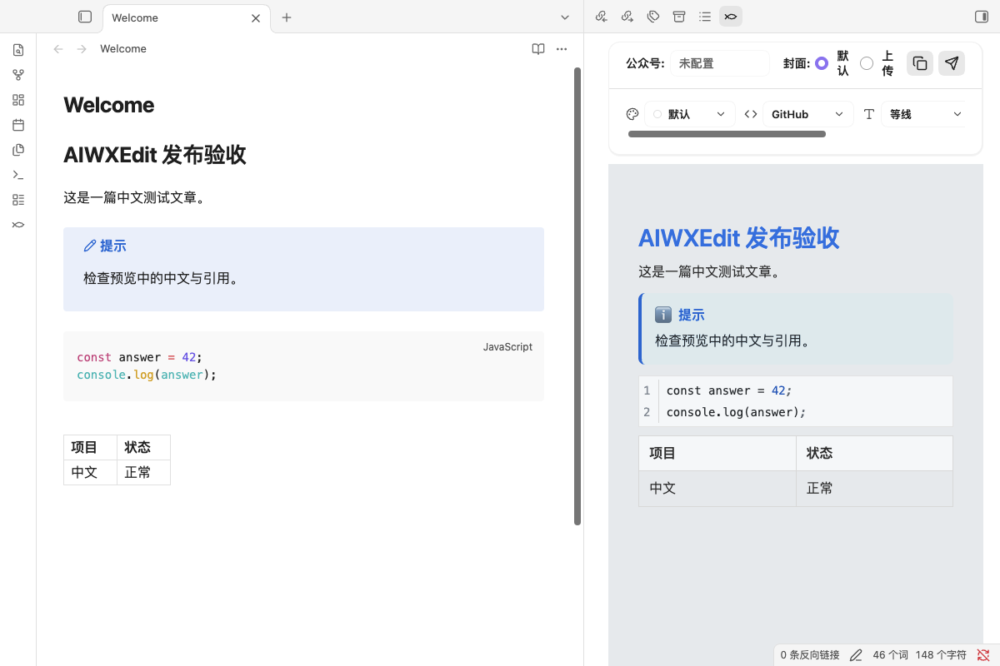

# AIWXEdit

English | [中文](#中文)

Format Markdown notes for WeChat Official Accounts (微信公众号), preview the result in a sidebar, and send articles to the account's **draft box**. Publishing a draft does not send an article to subscribers; review and publish it from WeChat yourself.



## Features

- **Markdown rendering** — headings, lists, tables, blockquotes, callouts, images, and code highlighting with optional line numbers.
- **Theme system** — built-in article themes plus theme color, font family, and font size controls; a built-in theme market for article themes and 70+ code highlight styles with batch download and uninstall; custom CSS support.
- **WeChat publishing** — a responsive draft composer with author/summary prefill, covers, original-page links, comment permissions, account defaults, and explicit selection of an existing draft article to update.
- **Local image upload** — when an account is configured, copying or publishing uploads local article images to WeChat so they display correctly in the editor.
- **Rich-text copying** — one click copies formatted HTML and plain text for pasting into the WeChat editor or other tools.
- **Original links** — link destinations stay on their original text, without numbered citations or an appended reference section. Reference-list entries such as `[Name]：https://example.com` are also supported.
- **Optional AI assistance** — title suggestions and AI cover generation through your own OpenAI-compatible provider (presets for OpenAI, OpenRouter, DeepSeek, Kimi/Moonshot, and Zhipu).
- **Entry points** — ribbon icon, command palette (**打开发布视图**, **发布当前笔记**), and a right-click menu item on Markdown files.

The interface is primarily in Chinese. LaTeX formula rendering is not currently implemented.

Requires Obsidian 1.7.2 or later. Desktop clipboard copying uses Electron when available; mobile uses browser clipboard APIs. Mobile devices have not yet been verified in this release candidate.

## Installation

### From Community Plugins (recommended)

1. Open **Settings → Community plugins**.
2. Click **Browse** and search for **AIWXEdit**.
3. Click **Install**, then **Enable**.

### Manual installation

1. Download `main.js`, `manifest.json`, and `styles.css` from a [public release](https://github.com/IsHexx/AIWXEdit/releases).
2. Create `<vault>/<config-folder>/plugins/aiwxedit/` (the default config folder is `.obsidian`).
3. Put the three files in that directory, restart Obsidian, and enable **AIWXEdit** under **Settings → Community plugins**.

Only these three files are required. Default article styling and code highlighting work without a separate `assets` folder. Downloaded styles and custom CSS are stored under the plugin's `assets` folder.

## Setup and use

1. Open **Settings → AIWXEdit** and add a WeChat Official Account's `AppID` and `AppSecret`. Your account needs access to the relevant WeChat draft and material APIs. Obtain credentials and configure any required IP allowlist in the [WeChat Official Accounts Platform](https://mp.weixin.qq.com/).
2. Open a Markdown note. Use the ribbon button or the command **AIWXEdit: 打开发布视图** to open the preview.
3. Choose the account and article style. Select a cover, or choose one in the publishing dialog.
4. Click the send button, review the title, cover, author, and summary, and confirm to create or update a WeChat draft.
5. Review the draft in WeChat before publishing it to subscribers.

The sidebar preview has reading space; copied and published article HTML keeps zero outer margins. The draft dialog reads note properties before account defaults, extracts a summary when none is provided, and lets you remember the author and comment permissions for each account. New drafts never silently replace a same-title article. To update a draft, explicitly select the article (including an individual article in a multi-article draft).

Supported note properties include `title`, `author`, `digest` (also `summary`/`description`), `cover`, `content_source_url` (also `source_url`), `need_open_comment`, and `only_fans_can_comment`. Comment values accept YAML booleans or 0/1. Originality declarations, reprint permissions, rewards, paid content, and sending/scheduling still require confirmation in WeChat; the [public draft API](https://developers.weixin.qq.com/doc/service/api/draftbox/draftmanage/api_draft_add.html) does not expose an originality declaration parameter. The dialog shows this distinction before and after saving.

The copy button writes formatted HTML and plain text to your clipboard. **When an account is configured, copying also attempts to upload local article images to WeChat**, so pasted images can be displayed there. Without an account, local images are embedded where supported. Clipboard capabilities vary between desktop and mobile; plain-text copying is the final fallback.

Optional AI tools require enabling AI in settings and providing your own API key. Provider/model support and image generation availability depend on your selected service. Previewing and styling notes do not require AI or an API key.

## Network, accounts, and privacy

The plugin has no client-side analytics or telemetry. Network requests are made for the following features:

| Feature | Remote service and data |
| --- | --- |
| Account connection test and draft operations | `api.weixin.qq.com`: account credentials to obtain an access token; tokens, article HTML, metadata, covers, and images for the requested operation. |
| Image previews | Images referenced by the note, selected WeChat materials, or generated covers can load from their original hosts, including WeChat image hosts such as `mmbiz.qpic.cn` and `mmbiz.qlogo.cn`. |
| Optional AI | Your configured OpenAI-compatible endpoint. Presets include OpenAI, OpenRouter, DeepSeek, Kimi/Moonshot, and Zhipu. Title generation sends article text and prompts; cover generation sends the title, summary, and prompt. Connection testing also contacts the selected provider. |
| Optional theme/highlight downloads | `cdn.jsdelivr.net` and `raw.githubusercontent.com`, or a CSS URL you add yourself. Requests fetch CSS when you choose to download a style; CSS can reference remote images or fonts. |

WeChat publishing requires a WeChat Official Account with the necessary API permissions. AI services may charge usage fees independently of this free, MIT-licensed plugin; you supply and manage those accounts. Data sent to an external service is subject to that service's policies.

Settings, WeChat `AppSecret` values, and AI API keys are saved **unencrypted** in the plugin's `data.json` inside your vault's configuration folder. Protect that folder and consider whether your vault sync, backups, or Git repository include it. Access tokens are cached in memory. The plugin does not read files outside your vault or automatically publish to subscribers.

## Development

Use Node.js 22 and npm:

```bash
npm ci
npm run check
npm run dev
```

`npm run build` produces the root `main.js`. Release validation and submission instructions are in [docs/RELEASING.md](docs/RELEASING.md).

## License and attribution

MIT; see [LICENSE](LICENSE). Code block rendering and WeChat HTML compatibility include code derived from [sunbooshi/note-to-mp](https://github.com/sunbooshi/note-to-mp), copyright 2024 sunbooshi, under MIT. See [THIRD_PARTY_NOTICES.md](THIRD_PARTY_NOTICES.md) and [LICENSES](LICENSES/) for all notices and license texts.

---

# 中文

[English](#aiwxedit) | 中文

将 Markdown 笔记排版为微信公众号格式，在侧边栏实时预览，并一键发送到公众号**草稿箱**。创建草稿不会群发给订阅者；发布前请在微信公众平台自行审阅。


## 功能特性

- **Markdown 渲染** —— 支持标题、列表、表格、引用、Callout、图片，以及可开关行号的代码高亮。
- **主题系统** —— 内置多套文章主题，支持主题色、字体、字号调节；内置主题市场，提供文章主题与 70+ 代码高亮样式的批量下载与卸载；支持自定义 CSS。
- **公众号发布** —— 自适应草稿弹窗，支持作者与摘要预填、封面、阅读原文链接、留言权限、账号默认偏好，以及选择具体草稿文章进行更新。
- **本地图片上传** —— 配置公众号后，复制或发布会自动把文中本地图片上传到微信素材库，保证编辑器内正常显示。
- **富文本复制** —— 一键复制排版后的 HTML 与纯文本，可直接粘贴到微信编辑器或其他工具。
- **可选 AI 智能服务** —— 通过你自己的 OpenAI 兼容接口生成标题建议与 AI 封面（内置 OpenAI、OpenRouter、DeepSeek、Kimi/Moonshot、智谱 预设）。
- **多种入口** —— 左侧 ribbon 图标、命令面板（**打开发布视图**、**发布当前笔记**）、Markdown 文件右键菜单。
- **原文链接** —— 网址直接保留在链接名称上，不添加论文式编号或文末参考链接列表；也支持参考资料中的 `[名称]：https://example.com` 写法。

界面以中文为主。暂不支持 LaTeX 公式渲染。

需要 Obsidian 1.7.2 或更高版本。桌面端复制优先使用 Electron 剪贴板能力，移动端使用浏览器剪贴板 API；本版本尚未在移动端完整验证。

## 安装

### 从社区插件市场安装（推荐）

1. 打开 **设置 → 第三方插件**。
2. 点击 **浏览**，搜索 **AIWXEdit**。
3. 点击 **安装**，然后**启用**。

### 手动安装

1. 从 [Releases 页面](https://github.com/IsHexx/AIWXEdit/releases) 下载 `main.js`、`manifest.json`、`styles.css` 三个文件。
2. 在库的配置目录（默认 `.obsidian`）下创建 `plugins/aiwxedit/` 文件夹。
3. 把三个文件放入该目录，重启 Obsidian，在 **设置 → 第三方插件** 中启用 **AIWXEdit**。

只需要这三个文件。默认文章样式与代码高亮无需单独的 `assets` 目录；下载的样式与自定义 CSS 保存在插件的 `assets` 目录下。

## 配置与使用

1. 打开 **设置 → AIWXEdit**，添加公众号的 `AppID` 与 `AppSecret`。公众号需开通草稿箱与素材库相关接口权限。可在[微信公众平台](https://mp.weixin.qq.com/)获取凭证，并按需配置 IP 白名单。
2. 打开一篇 Markdown 笔记，点击左侧 ribbon 图标，或使用命令 **AIWXEdit: 打开发布视图** 进入预览。
3. 选择公众号与文章样式，选择或上传封面。
4. 点击发送按钮，核对标题、封面、作者与摘要，确认后创建或更新微信草稿。
5. 回到微信公众平台审阅草稿，再自行发布给订阅者。

侧栏预览保留阅读留白，复制和发布的文章 HTML 保持外层零边距。弹窗优先读取笔记属性，再使用账号默认值；未设置摘要时从正文提取。可勾选记住该账号的作者和留言权限。默认新建草稿，不会自动覆盖同名文章；更新时需明确选择文章，多图文草稿可以选择其中一篇。

可预填的笔记属性：`title`、`author`、`digest`（也支持 `summary` / `description`）、`cover`、`content_source_url`（也支持 `source_url`）、`need_open_comment`、`only_fans_can_comment`。留言属性支持 YAML 布尔值或 0/1。原创声明、转载权限、赞赏、付费、群发与定时发送仍需在微信后台确认；[公开草稿接口](https://developers.weixin.qq.com/doc/service/api/draftbox/draftmanage/api_draft_add.html)未提供原创声明参数，弹窗会在保存前后提示。

复制按钮会把排版后的 HTML 与纯文本写入剪贴板。**配置公众号后，复制时会同时尝试上传文中本地图片到微信**，使粘贴的图片可以正常显示；未配置公众号时，本地图片在支持的场景下以内嵌方式处理。桌面与移动端剪贴板能力不同，纯文本复制是最终兜底。

AI 功能需在设置中开启并填入你自己的 API 密钥。服务商/模型能力与图片生成可用性取决于你选择的服务。预览与排版不需要 AI，也不需要 API 密钥。

## 网络、账号与隐私

插件不含任何客户端统计或遥测。以下功能会产生网络请求：

| 功能 | 远程服务与数据 |
| --- | --- |
| 账号连接测试与草稿操作 | `api.weixin.qq.com`：使用账号凭证获取 access_token；按操作需要传输文章 HTML、元数据、封面与图片。 |
| 图片预览 | 笔记引用的图片、所选微信素材或生成的封面可能从其原始地址加载，包括 `mmbiz.qpic.cn`、`mmbiz.qlogo.cn` 等微信图片服务。 |
| 可选 AI 服务 | 你配置的 OpenAI 兼容接口。预设包括 OpenAI、OpenRouter、DeepSeek、Kimi/Moonshot、智谱。标题生成发送文章文本与提示词；封面生成发送标题、摘要与提示词；连接测试会访问所选服务商。 |
| 可选主题/高亮下载 | `cdn.jsdelivr.net` 与 `raw.githubusercontent.com`，或你自行添加的 CSS 地址。仅在你选择下载样式时请求；CSS 可能引用远程图片或字体。 |

公众号发布需要具备相应接口权限的微信公众账号。AI 服务可能独立于本免费（MIT 许可）插件产生费用；相关账号由你自行提供与管理。发送到外部服务的数据受该服务的政策约束。

设置、微信 `AppSecret` 与 AI API 密钥以**明文**保存在库配置目录下插件的 `data.json` 中。请保护好该目录，并评估你的库同步、备份或 Git 仓库是否包含它。access_token 仅缓存在内存中。插件不会读取库以外的文件，也不会自动向订阅者发布。

## 开发

使用 Node.js 22 与 npm：

```bash
npm ci
npm run check
npm run dev
```

`npm run build` 在根目录生成 `main.js`。发布校验与提交说明见 [docs/RELEASING.md](docs/RELEASING.md)。

## 许可与致谢

MIT，详见 [LICENSE](LICENSE)。代码块渲染与微信 HTML 兼容层包含源自 [sunbooshi/note-to-mp](https://github.com/sunbooshi/note-to-mp)（Copyright 2024 sunbooshi，MIT）的代码。完整第三方声明见 [THIRD_PARTY_NOTICES.md](THIRD_PARTY_NOTICES.md) 与 [LICENSES](LICENSES/)。
